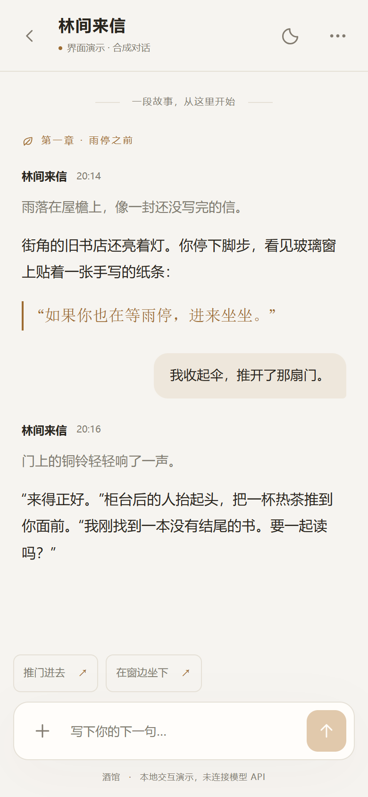
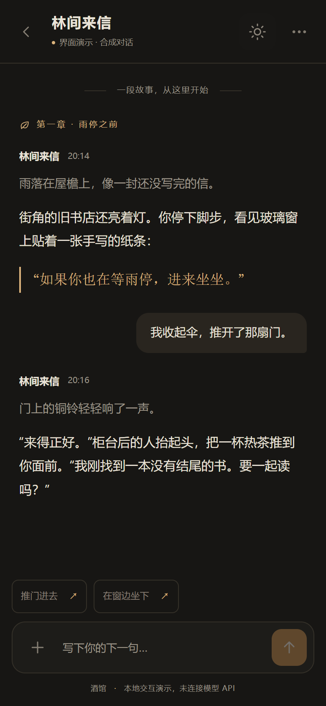

<div align="center">

# 酒馆 · Jiuguan

**把 SillyTavern 装进口袋。**

在 Android 手机上运行原版 SillyTavern 前后端，配上为触屏重新整理的中文界面。

[下载 APK](https://github.com/zjldg666/jiuguan/releases) · [构建说明](docs/ANDROID-BUILD.md) · [实测记录](docs/UPSTREAM-STATUS.md) · [反馈问题](https://github.com/zjldg666/jiuguan/issues)

Android 8.0+ · arm64-v8a · Kotlin / WebView / Node.js

</div>

## 一个 APK，手机自己运行

酒馆将 Android 原生外壳、Node.js 运行时和 SillyTavern 前后端打包在一起。安装后，App 自动启动手机本地服务，再用 WebView 打开界面；日常使用不需要电脑、手动安装 Termux 或输入启动命令。

模型由你选择和配置。App 不包含大模型权重，也不提供免费模型额度；使用远程模型时仍需要网络和相应 API 服务。

## 聊天界面演示

白天的暖白、黑夜的暖炭黑，配上一点琥珀色。以下为独立 README 演示页的浏览器截图，使用原创合成对话，不使用第三方角色卡或私人聊天。**这是界面演示，不是 Android 实机截图，也不代表 App 功能验收。**

<p align="center">
  
  
</p>

<p align="center">白天 · 黑夜</p>

打开本地 [演示页面](docs/demo/index.html) 可切换主题、选择三段故事并发送本地演示消息，无需 API Key。截图与演示说明见 [截图说明](docs/images/README.md)，正式包验证状态见 [1.2.17 发布说明](docs/RELEASE-1.2.17.md)。

## 可以做什么

- **管理角色与会话**：角色卡列表、搜索与导入入口，最近聊天、会话备注和删除操作。
- **使用原版生成能力**：沿用 SillyTavern 的模型连接、普通与 SSE 流式回复、预设和提示词机制。
- **编辑世界书与预设**：世界书拥有独立底部导航与可搜索书库；全局启用、角色绑定和编辑操作区分清晰，保留原版保存逻辑与数据格式。
- **使用常用扩展**：固定版本内置酒馆助手 4.12.0、提示词模板 1.17.9；可从原版扩展面板管理。
- **适合手机的布局**：白天 / 黑夜 / 跟随系统三种外观设置，聊天 / 角色 / 世界书 / 设置四项导航，紧凑表单，以及键盘、安全区和返回键适配。
- **控制长聊天显示量**：减少同时渲染的消息数量，保留向上加载历史的能力；显示限制不等于删除聊天或缩短模型上下文。
- **沿用原版工具**：设置页直接呈现原版工具与扩展入口；手机界面作为标准前端扩展加载，上游核心源码保持固定版本。

当前固定 **SillyTavern 1.19.0**。本项目是独立 Android 宿主与手机界面适配项目，并非 SillyTavern 官方 Android 发行版。

## 下载与开始使用

1. 打开 [Releases](https://github.com/zjldg666/jiuguan/releases)，下载 `jiuguan-版本号-arm64-v8a.apk`。
2. 在 Android 8.0 及以上的 arm64 设备上安装。首次打开需要展开内置资源，请等待启动完成。
3. 进入 **设置 → 模型 API**，配置你使用的服务、模型和密钥。
4. 在 **角色** 页导入自己的角色卡，打开角色后开始聊天；世界书、预设和扩展从设置进入。

正式包名为 `io.jiuguan.mobile`，开发包名为 `io.jiuguan.mobile.debug`。两者可以共存，数据互相独立，不会自动迁移。更新同一应用需沿用原有签名；不要用卸载或清空数据处理签名冲突。

下载页提供 SHA-256 校验文件。当前仅支持 arm64，尚未提供 x86 或 32 位 ARM 安装包。

## 数据如何保存

SillyTavern 服务和数据位于手机应用私有目录，业务数据存放于 `files/tavern/data`。内置资源按内容散列展开，更新资源与用户数据分开处理。系统自动备份已关闭，卸载应用可能丢失本地数据。

调用远程模型时，生成所需的内容会发送到你配置的模型服务；第三方扩展也可能访问其外部服务。完整备份、Blob 导出、凭据排除和旧客户端迁移仍需继续完善与验证，请自行保管原始角色卡和重要数据。

## 从源码构建

开发工具：**Git、Node.js ≥ 20、JDK 21、Android SDK 35 / Build Tools 35.0.0**。项目自带 Gradle Wrapper。

```powershell
git clone https://github.com/zjldg666/jiuguan.git
cd jiuguan
npm ci
npm run upstream:prepare
npm run extensions:prepare
```

按 [完整构建说明](docs/ANDROID-BUILD.md) 下载并校验固定 Android 运行时，在本机配置 SDK 路径，再执行：

```powershell
# 将路径替换为本机安装位置
$env:JAVA_HOME = 'C:/Java/jdk-21'
$env:JIUGUAN_NODE = 'C:/Program Files/nodejs/node.exe'
.\gradlew.bat :app:assembleDebug "-PnodeExecutable=$env:JIUGUAN_NODE"
```

开发 APK 输出到 `app/build/outputs/apk/debug/app-debug.apk`。新环境会生成自己的开发签名，因此不能直接覆盖其他人签名的同包名应用。正式构建需要私有签名配置，签名密钥不在仓库中。

资源准备需要网络；完成打包后，App 运行本地服务不依赖开发电脑。

## 验证范围

项目将“编译成功”“桌面隔离测试”“真机验证”分别记录，不将它们互相替代。

- 已有真机记录覆盖独立启动、角色导入、模拟模型普通/SSE 请求、聊天保存、强制停止后恢复，以及多轮界面和键盘检查。
- 深色界面的历史验收覆盖 320–768px 布局、预设/世界书编辑、原版模型请求一致性，以及 vivo V2520A 上的安装版截图。
- 具体版本、设备和未测范围见 [实测记录](docs/UPSTREAM-STATUS.md)；本次发布检查见 [1.2.17 发布说明](docs/RELEASE-1.2.17.md)。历史测试不自动代表每个新版本都已重新验收。

准备好上游源码与 Chromium 后，可运行：

```powershell
$env:JIUGUAN_CHROME = 'C:/Program Files/Google/Chrome/Application/chrome.exe'
npm run test:mobile-ui
npm run test:world-info-mobile
npm run test:preset-mobile
npm run test:compact-ui
```

这些隔离回归使用合成数据与本机模拟模型，不调用付费模型。`android:smoke` 等真机脚本另需显式设置设备和测试开关，可能强制停止开发包并创建验收数据，详见构建说明。

## 当前边界

- 第三方扩展、复杂角色卡和群聊组合仍需逐项验证，**不承诺完整插件兼容**。
- Android 系统和厂商省电策略可能终止后台服务，不承诺永久保活。
- WebSpeech TTS、原生文件导入导出的完整流程、备份与迁移、多设备覆盖仍有待完善。
- 原生 Node 运行时目前取自固定公开发布包，来源与散列已锁定；独立可复现的运行时构建尚未完成。

## 项目结构

```text
app/src/main/
  java/io/jiuguan/mobile/           Android 启动、服务与运行时管理
  assets/extensions/jiuguan-mobile/ 手机界面扩展
  res/                             原生资源与样式
platform/upstream/                 上游源码、扩展和运行时来源锁
scripts/upstream/                  资源准备、打包核验与回归脚本
gradle/wrapper/                    固定版本 Gradle Wrapper
docs/                             构建、实测、发布与截图说明
```

构建缓存、下载的上游副本、用户数据、API 密钥、签名证书和完整本地测试产物均不提交。旧 HBuilderX / uni-app 客户端已退出主线。

## 来源与许可

感谢 [SillyTavern](https://github.com/SillyTavern/SillyTavern)、[ST-android](https://github.com/Sanitised/ST-android)、[酒馆助手](https://github.com/N0VI028/JS-Slash-Runner) 和 [提示词模板](https://github.com/zonde306/ST-Prompt-Template)。

第三方组件分别遵循其原有许可：SillyTavern 与提示词模板为 AGPL-3.0，酒馆助手为 **PolyForm Noncommercial 1.0.0**，Node.js 保留其许可及依赖声明。来源、固定提交和许可说明见 [THIRD_PARTY_NOTICES.md](THIRD_PARTY_NOTICES.md)。公开仓库不改变第三方内容的许可。

角色卡、卡面和用户导入内容的权利归各自作者所有。

## 反馈与参与

欢迎通过 [Issues](https://github.com/zjldg666/jiuguan/issues) 提交问题。请附上应用版本、手机型号、Android 版本、复现步骤和已去除敏感信息的截图；兼容性问题请注明扩展与角色卡相关格式。请勿上传 API Key、私人聊天、签名文件或完整个人数据目录。
